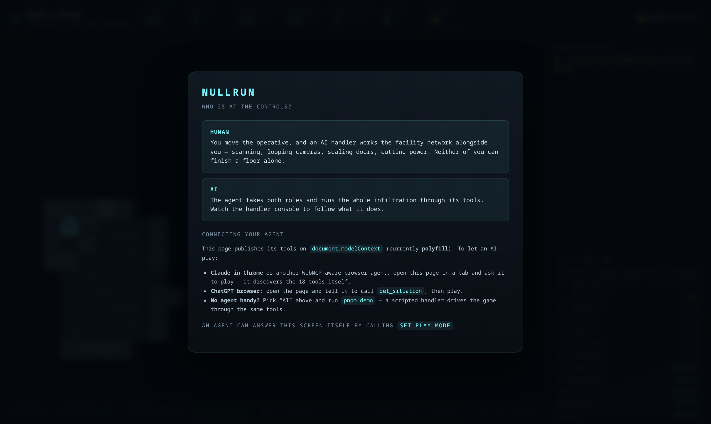
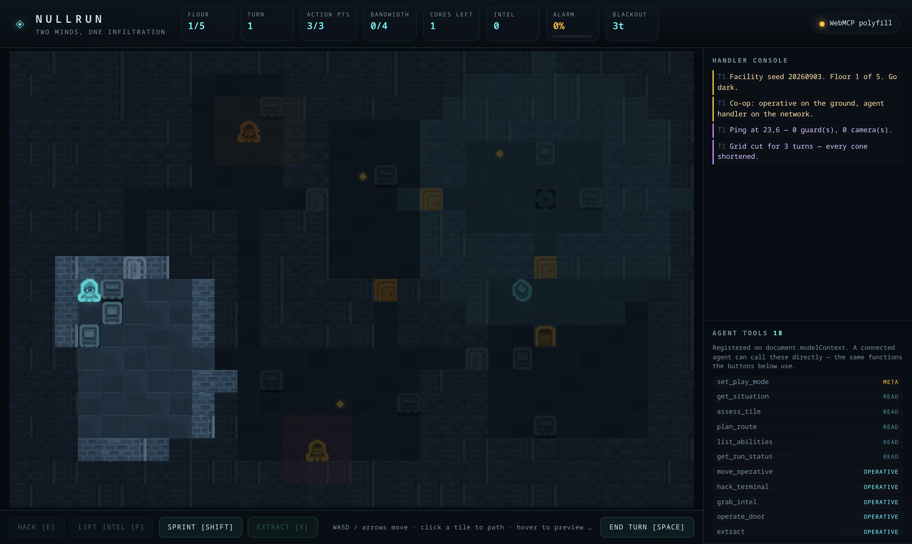
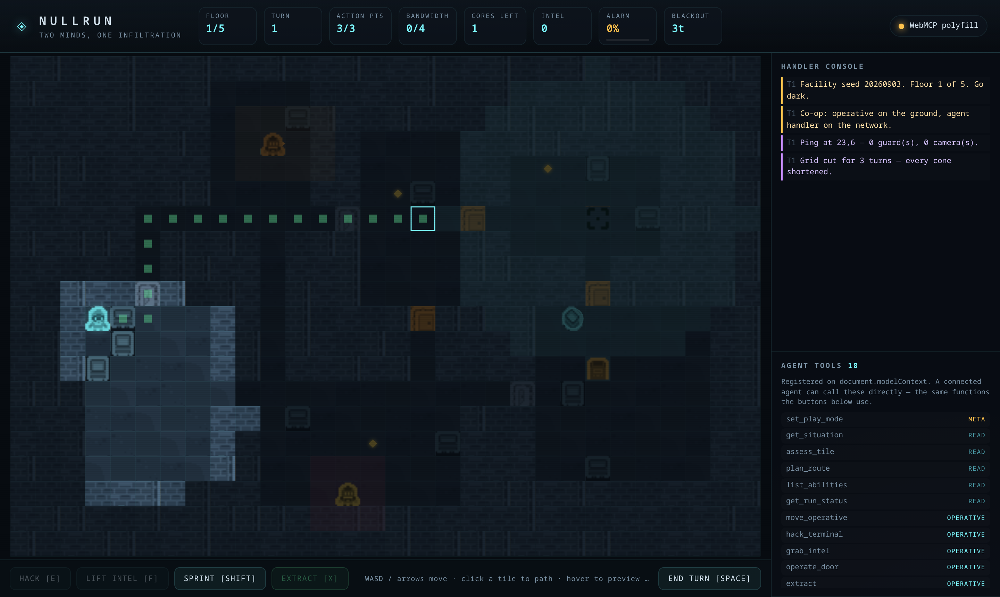
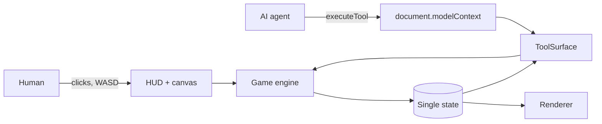

# NULLRUN

**A turn-based stealth roguelite built to be played by a human and an AI agent *at the same time*, over [WebMCP](https://github.com/webmachinelearning/webmcp).**

You play the operative on the ground. Your handler is an AI agent wired in through
`document.modelContext`, and it never touches your controls. It works the building instead:
sweeping the network, looping camera feeds, blowing speakers to drag patrols off your path,
slamming blast doors in a guard's face, rewriting patrol orders. You move through the gaps it opens.

| | |
| --- | --- |
| **Live demo** | _add your deployed URL here_ |
| **Demo video** | _add your video link here_ |
| **Licence** | MIT |
| **Tool surface** | 18 tools on `document.modelContext` |



---

## The 60-second version

Most "AI-enabled" web apps hand the agent the same buttons the user already has. NULLRUN gives it a
**different set of verbs**, paid for out of its own resource pool, so the two roles complement each
other instead of overlapping.

| | Operative (human) | Handler (agent) |
| --- | --- | --- |
| Resource | 3 action points / turn | 4 bandwidth / turn |
| Can do | move, sprint, hack terminals, lift intel, extract | ping the network, loop cameras, seal doors, cut power, reroute patrols |
| Cannot do | see through walls, touch the grid | physically move, hack a terminal, carry anything |

**Neither side can finish a floor alone.** The agent is a second player class, not an
accessibility layer bolted onto the first.



---

## 1. Use case fit — why a game, and why this one

The obvious objection to a game submission is that agents have no reason to play one. NULLRUN
answers that by giving the agent work the human physically cannot do, in a format that suits how
WebMCP actually behaves.

**Turn-based is the integration, not a style choice.** Every tool call is a network round trip,
realistically 1–3 seconds. Put that in a real-time game and it reads as lag; the agent becomes a
sluggish side channel nobody wants to use. Put it in a turn-based tactical game and the same call
becomes an ordinary game action, with latency that simply stops mattering. The genre followed from
the transport.

**Information asymmetry drives the whole thing.** Your operative sees 8 tiles. The agent sees
whatever it has pinged. Because neither party holds the full picture, a handler is worth having and
the tools have something real to say.

**The shape generalises.** Drop the fiction and what remains is a template for any app where an
agent should hold context, watch state and act on the system while a person works the surface:
alert-watching dashboards, ops consoles, incident response, logistics. A game just makes that
division of labour legible in a way a chat sidebar never does.

---

## 2. How the agent experience improves the product

**Read tools hand back reasoning material, not pixels.** `plan_route` returns more than a path. You
get the risk attached to each step, the *name* of the guard or camera watching that step, and where
cover sits:

```json
{
  "length": 7, "apRequired": 7, "exposedSteps": 2,
  "mostDangerousStep": { "x": 14, "y": 9, "risk": 18, "watchedBy": ["guard-1", "cam-0"] },
  "steps": [ { "order": 1, "x": 9, "y": 9, "risk": 0, "watchedBy": [], "cover": true } ]
}
```

An agent can act on that. No agent can act on a screenshot. The same numbers feed the human's hover
preview, so both players read from one truth.



**Agents skip the interface entirely.** The opening screen and briefing exist for humans. If a
handler calls a gameplay tool on a cold page, the run simply starts — `ping_scan` on a fresh load
works. Read tools carry no side effects, so `get_situation` never kicks anything off, and a human
who already picked co-op keeps that choice.

**Tools show up only when they can be used.** `begin_infiltration` lives in the briefing and
vanishes the moment a floor starts. `choose_implant` exists while a choice is pending, and
`start_new_run` only once a run is over. No dead options cluttering the agent's menu.

**Costs are introspectable.** `list_abilities` reports what every action costs right now and whether
it is affordable, reading from the balance table the rules use. What the agent is told cannot drift
from what the engine does.

**Failures name their own fix.** `"No walkable route to 14,9. A sealed door may be in the way — try
cycle_door."` Every error is written for a reader who has to pick a next move.

**Control changes hands mid-run.** `set_play_mode` works at any point, so "you take over" lands
halfway through a floor rather than only at the menu.

**Every result tells the agent how to keep going.** A tool that only reports what happened leaves a
handler with no reason to take another turn, so it stalls after one call. Each action answers with
the live budget and a `nextSteps` list built from actual state — a hunting guard pushes
`cycle_door` to the front, an empty AP pool asks for `end_turn`, an undiscovered core suggests
`ping_scan`. Every entry names a registered tool and says why:

```json
{
  "actionPoints": 3, "bandwidth": 3, "alarm": 6, "turn": 1,
  "continue": "The run is still live — keep going by calling ping_scan.",
  "nextSteps": [
    { "tool": "ping_scan", "why": "No data core discovered yet. Sweep unexplored areas to find one before moving blind." },
    { "tool": "move_operative", "why": "3 AP left. Prefer a destination whose risk is 0 — ending a turn inside a cone is how runs end." }
  ]
}
```

**One engine serves both players.** Each tool calls the same method its UI button calls. No
agent-only code path exists to quietly drift from what a human sees.

---

## 3. Implementation

### The tool surface

**Read — free, side-effect free**

| Tool | What it gives an agent |
| --- | --- |
| `get_situation` | Full tactical snapshot: position, resources, alarm, discovered guards with facing and alert state, cameras, objectives, plus `playMode` and a `yourRole` sentence |
| `assess_tile` | Terrain, walkability, cover, and exactly which observers hold that tile |
| `plan_route` | Path with per-step risk, named watchers, AP cost, worst step |
| `list_abilities` | Live cost of every action and whether it is affordable right now |
| `get_run_status` | Floor, implants, intel this run, banked intel, end reason |

**Operative — costs action points**

| Tool | Cost |
| --- | --- |
| `move_operative` | 1 AP/tile, or 2 AP to sprint up to 3 tiles (noise radius 5) |
| `hack_terminal` | 2 AP (1 with Silent Splice) |
| `grab_intel` | 1 AP |
| `operate_door` | 1 AP, noise radius 3 |
| `extract` | free |
| `end_turn` | free |

**Handler — costs bandwidth**

| Tool | Cost | Effect |
| --- | --- | --- |
| `ping_scan` | 1 | Reveals terrain, guards and cameras around a point; nearby guards notice the probe |
| `cycle_door` | 1 | Opens a door, or **seals** it so guards cannot path through for 3 turns |
| `loop_camera` | 2 | Blinds a camera for 4 turns |
| `trigger_distraction` | 2 | Noise at a point; every guard in radius 8 abandons its patrol to investigate |
| `cut_power` | 3 | Every vision cone drops to 40% range for 3 turns |
| `reroute_patrol` | 2 | Spoofs a non-hunting guard's next waypoint |

**Meta** — `set_play_mode` (any time), `begin_infiltration`, `choose_implant`, `start_new_run`

### The WebMCP bridge

```ts
// src/webmcp/bridge.ts — prefer the browser's own implementation
if (document.modelContext) return { mode: 'native', context: document.modelContext };
initializeWebMCPPolyfill();                       // @mcp-b/webmcp-polyfill
return { mode: 'polyfill', context: document.modelContext };
```

Registration passes an `AbortSignal`, which lets phase-scoped sets swap cleanly. A badge in the top
right of the UI shows which mode you landed in.

### Architecture

```
src/game/      simulation — config (all tuning), mapgen, vision/threat, grid, engine
src/render/    atlas manifest, palette, effects, canvas renderer
src/ui/        HUD, overlays, action bar
src/webmcp/    bridge (native → polyfill) and the tool surface
tools/         asset pipeline, browser smoke check, eval generator + runner, agent demo
tests/         engine, WebMCP surface, invariants and fuzzing
```



Both players funnel into one engine holding one state. Balance lives in `src/game/config.ts`, and
the tools report straight from that table.

---

## Play modes

The first screen asks who is at the controls. An agent can read that answer and set it, so a
handler joining mid-run knows its role.

- **Human** — you move the operative while an AI handler works the network beside you.
- **AI** — the agent takes both roles and runs the infiltration itself.

### Connecting your agent

Tools are published on `document.modelContext`, so a WebMCP-aware agent finds them on its own.
Nothing to paste, no key to configure. From the spec's
[implementation status](https://github.com/webmachinelearning/webmcp/blob/main/implementation-status.md):

- **ChatGPT Desktop** — WebMCP is supported. Open the URL, tell it to play. No flags.
- **Chrome 149+ / Edge 150+** — origin trial is live, which needs Early Preview Program enrolment
  plus an origin-trial token for your deployed origin.
- **nekuda WebMCP Workbench** — a [Chrome extension](https://chromewebstore.google.com/detail/nekuda-webmcp-workbench/amochnnbmnkjjlblolhpddkokhnalkjp)
  that lists a page's tools and drives them with an agent, bring your own key. Fastest way to play
  co-op today without origin-trial enrolment.
- **Brave** — experimental, through Leo.
- **No agent handy** — pick *AI* and run `pnpm demo`.

---

## The game

Five floors of a procedurally generated facility. Siphon every data core, reach the extraction pad,
pick an implant, descend. Intel banks between runs.

- Guards carry vision cones and hearing, and move through three alert states: patrol, suspicious, hunting.
- Cover breaks line of sight past 2 tiles. Sprinting makes noise, and noise pulls patrols.
- Being seen raises the alarm. Hit **100%** and the facility locks down with you inside.
- A hunting guard that reaches you ends the run on the spot, unless a Reflex Governor is installed.
- Sealed doors genuinely reroute pathfinding. Guard AI and route planner both respect them.
- Nine implants: extra AP, silent sprint, wider scans, cheaper blackouts, faster alarm decay, and more.

**Controls:** WASD/arrows move · click to path · hover to preview route risk · `E` hack · `F` lift
intel · `Shift` sprint · `X` extract · `Space` end turn.

---

## Quickstart

```bash
pnpm install
pnpm dev            # http://localhost:5173

pnpm test           # 39 tests: engine, WebMCP surface, invariants, fuzzing
pnpm smoke          # drives the real page in Chromium, incl. document.modelContext
pnpm demo           # a handler plays the game using only the WebMCP tools
pnpm evals:build    # regenerate the 313-case eval matrix
pnpm evals          # execute all 313 against the live page + a success-path pass
pnpm assets         # rebuild the tile atlas from the Kenney source art
pnpm build
```

`pnpm smoke`, `pnpm demo` and `pnpm evals` want a dev server on port 5183
(`npx vite --port 5183`), or take a URL as their first argument.

---

## Verification

`pnpm demo` is the sharpest completeness check available. A handler with **only** the public tool
surface, no DOM access and no engine access, sits down and plays. It pings to find cores, reads
`plan_route` risk, loops cameras, fires distractions, seals doors on hunters, and refuses to finish
a turn standing in a vision cone. On the default seed it clears **two floors** in roughly 160 tool
calls. A script that can clear floors armed with nothing but the tools tells you the surface is
complete.

```
T3 floor 1 · ap 3 · bw 4 · alarm 0% · cores left 1
  · route 22 steps, 1 exposed, risk 7
  → cut_power (shorten every cone): Power cut for 3 turns. All vision ranges drop to 40%.
  → move_operative (toward the core, ending on risk 0): Reached 7,12 in 3 step(s).

T5 floor 1 · ap 3 · bw 4 · alarm 0% · cores left 1
  · route 16 steps, 3 exposed, risk 27
  → trigger_distraction (pull guard-1 off the route): Distraction fired at 19,17; 1 guard investigating.
```

Past that, the suite goes wide on purpose rather than parading a few happy paths:

| Sweep | Scale |
| --- | --- |
| Floor invariants | 300 seeds × 5 floors — connectivity, nothing inside geometry, every core reachable |
| Fuzzed play | 200 runs × 120 random tool actions — **>10,000 actions**, state invariants asserted after every one |
| Resource safety | 120 runs proving AP and bandwidth can never rise mid-turn |
| Vision consistency | every tile of 40 floors: a reported watcher must have real line of sight and range |
| Blackout monotonicity | **~24,000 tile comparisons** — cutting power can only ever remove watchers |
| Determinism | same seed rebuilds an identical floor; 120 seeds give near-unique layouts |
| Tool-choice evals | **313 generated cases across 18 tools** (`tools/build-evals.mjs`) |
| Eval execution | all 313 executed against the live page via `executeTool`, plus a 19-check success-path pass proving every tool can *succeed*, not merely respond |
| Browser smoke | 15 checks on the real page: rendering, HUD survival under input, control occlusion, agent tool calls, zero console errors |

Assertions were mutation-checked: the code was deliberately broken to confirm the tests notice.
Where a single-line mutation slipped through, the test got strengthened until it caught the change.

### Bugs this verification actually caught

- **A tool aborted its own registration mid-call.** A phase change fired inside `execute()`
  cancelled the registration belonging to the very tool that triggered it, so callers received
  `"Tool unregistered"` in place of their result. Phase syncs now yield a task first.
- **Closed doors made objectives unreachable.** Pathfinding treated every shut door as a wall, which
  left generated floors reporting cores and extraction as unreachable. Unlocked doors are now
  pathable and get opened in passing; only *sealed* ones block.
- **The canvas painted over the action bar.** A positioned wrapper let an over-tall canvas swallow
  every enabled button. Containment plus a `ResizeObserver` fixed it, and an occlusion hit-test now
  runs inside the smoke check.
- **`set_play_mode` vanished once playing**, which meant control could never pass to an agent
  mid-run. The eval pass surfaced it; promoting it to a core tool fixed it.

Two of my own invariants turned out to be wrong, and the *tests* were corrected rather than the
code: seeing a wall face is perfectly legitimate, and the fuzz sweep needed a real timeout.

---

## Design decisions worth knowing

- **Turn-based** so tool latency stops being a problem at all (see §1).
- **Asymmetric verbs** so the agent never degenerates into a redundant remote control.
- **Fog of war on both sides**, which is what gives `ping_scan` a reason to exist.
- **A single balance table** (`src/game/config.ts`) feeding both the rules and the tool
  descriptions, so agent-facing documentation cannot drift out of sync.
- **An art pipeline instead of committed blobs.** `tools/build-atlas.sh` pushes CC0 Kenney sprites
  through a luminance ramp into the game palette, keeping the palette reproducible and editable.

## Limitations

- Chrome and Edge need origin-trial enrolment. Without it the page falls back to the polyfill, which
  registers identical tools, so behaviour matches and only discovery differs.
- The handler behind `pnpm demo` is a heuristic, not an LLM. Its job is proving the tool surface is
  sufficient and giving a repeatable demo. A real agent plays better.
- Guard AI stays deliberately readable (patrol, investigate, hunt) rather than clever. The tactical
  interest comes from two players splitting the work.

## Credits

Environment and character art derived from [Kenney](https://kenney.nl) "Tiny Dungeon" (CC0),
recoloured into the NULLRUN palette by `tools/build-atlas.sh`. WebMCP polyfill by
[@mcp-b](https://www.npmjs.com/package/@mcp-b/webmcp-polyfill). Effects, HUD, layout, engine and
tool design are original.

Licensed MIT — see [LICENSE](LICENSE).
