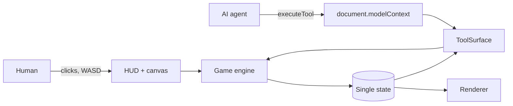

# NULLRUN

**A turn-based stealth roguelite built to be played by a human and an AI agent *at the same time*, over [WebMCP](https://github.com/webmachinelearning/webmcp).**

You are the operative on the ground. Your handler is an AI agent connected through
`document.modelContext`. It does not press your buttons — it works the building. It sweeps the
network, loops camera feeds, blows speakers to pull patrols, seals blast doors in a guard's face
and spoofs patrol routes, while you move through the gaps it opens.

| | |
| --- | --- |
| **Live demo** | _add your deployed URL here_ |
| **Demo video** | _add your video link here_ |
| **Licence** | MIT |
| **Tool surface** | 18 tools on `document.modelContext` |


---

## The 60-second version

Most "AI-enabled" web apps expose the things a user could already click. NULLRUN gives the agent a
**different set of verbs from the human**, backed by its own resource, so the two roles are not
redundant — they are complementary.

| | Operative (human) | Handler (agent) |
| --- | --- | --- |
| Resource | 3 action points / turn | 4 bandwidth / turn |
| Can do | move, sprint, hack terminals, lift intel, extract | ping the network, loop cameras, seal doors, cut power, reroute patrols |
| Cannot do | see through walls, touch the grid | physically move, hack a terminal, carry anything |

**Neither side can finish a floor alone.** The agent is a second player class, not an
accessibility layer over the first.


---

## 1. Use case fit — why a game, and why this one

The honest risk with a game submission is that agents have no reason to play. NULLRUN is built so
the agent has a *job* the human physically cannot do, and so the medium suits the transport:

**Turn-based is the integration, not a style choice.** A WebMCP tool call is a network round trip —
call it 1–3 seconds. In a real-time game that is lag, and the agent integration degrades into a
laggy side channel. In a turn-based tactical game every tool call is a first-class game action and
latency stops mattering entirely. The genre was chosen *because of* the transport.

**The information asymmetry is the design.** The operative sees an 8-tile radius. The agent sees
whatever it pings. Neither has the whole picture, which is what makes a handler worth having and
what gives the tools something real to communicate.

**It generalises.** Strip the fiction and this is a pattern for any app where an agent should hold
context, watch state and act on the system while a human works the surface: dashboards with an
agent watching alerts, ops consoles, incident response, logistics. The game is a legible way to
show a co-operative division of labour that a chat sidebar cannot express.

---

## 2. How the agent experience improves the product

**Read tools return reasoning material, not pixels.** `plan_route` does not just return a path. It
returns each step's risk, *which named guard or camera watches that step*, and where cover exists:

```json
{
  "length": 7, "apRequired": 7, "exposedSteps": 2,
  "mostDangerousStep": { "x": 14, "y": 9, "risk": 18, "watchedBy": ["guard-1", "cam-0"] },
  "steps": [ { "order": 1, "x": 9, "y": 9, "risk": 0, "watchedBy": [], "cover": true } ]
}
```

An agent can reason about that. It cannot reason about a screenshot. The same data drives the
human's hover preview, so both players are looking at the same truth.


**Agents never touch the interface.** The opening screen and briefing are human affordances. A
handler that calls any gameplay tool on a cold page starts the run itself — `ping_scan` on a fresh
load just works. Read tools stay side-effect free, so `get_situation` never starts anything, and a
human who already chose co-op keeps that choice.

**Tools exist only when they are usable.** `begin_infiltration` appears during the briefing and
disappears once the floor starts. `choose_implant` exists only while a choice is pending.
`start_new_run` only after a run ends. The agent's menu is never full of dead options.

**Costs are introspectable.** `list_abilities` reports every action's live cost and whether it is
currently affordable, read from the same balance table the rules use — so what the agent is told
cannot drift from what the engine does.

**Failures name their own fix.** `"No walkable route to 14,9. A sealed door may be in the way — try
cycle_door."` Errors are written for a reader who has to decide what to do next.

**Control can change hands mid-run.** `set_play_mode` is callable at any point, so "you take over"
works halfway through a floor, not just at the menu.

**One engine, both players.** Every tool calls the exact method the UI button calls. There is no
agent-only code path that can silently drift from what a human sees.

---

## 3. Implementation

### The tool surface

**Read — free, side-effect free**

| Tool | What it gives an agent |
| --- | --- |
| `get_situation` | Full tactical snapshot: position, resources, alarm, discovered guards with facing and alert state, cameras, objectives, plus `playMode` and a `yourRole` sentence |
| `assess_tile` | Terrain, walkability, cover, and exactly which observers hold that tile |
| `plan_route` | Path with per-step risk, named watchers, AP cost, worst step |
| `list_abilities` | Live cost of every action and whether it is affordable right now |
| `get_run_status` | Floor, implants, intel this run, banked intel, end reason |

**Operative — costs action points**

| Tool | Cost |
| --- | --- |
| `move_operative` | 1 AP/tile, or 2 AP to sprint up to 3 tiles (noise radius 5) |
| `hack_terminal` | 2 AP (1 with Silent Splice) |
| `grab_intel` | 1 AP |
| `operate_door` | 1 AP, noise radius 3 |
| `extract` | free |
| `end_turn` | free |

**Handler — costs bandwidth**

| Tool | Cost | Effect |
| --- | --- | --- |
| `ping_scan` | 1 | Reveals terrain, guards and cameras around a point; nearby guards notice the probe |
| `cycle_door` | 1 | Opens a door, or **seals** it so guards cannot path through for 3 turns |
| `loop_camera` | 2 | Blinds a camera for 4 turns |
| `trigger_distraction` | 2 | Noise at a point; every guard in radius 8 abandons its patrol to investigate |
| `cut_power` | 3 | Every vision cone drops to 40% range for 3 turns |
| `reroute_patrol` | 2 | Spoofs a non-hunting guard's next waypoint |

**Meta** — `set_play_mode` (any time), `begin_infiltration`, `choose_implant`, `start_new_run`

### The WebMCP bridge

```ts
// src/webmcp/bridge.ts — prefer the browser's own implementation
if (document.modelContext) return { mode: 'native', context: document.modelContext };
initializeWebMCPPolyfill();                       // @mcp-b/webmcp-polyfill
return { mode: 'polyfill', context: document.modelContext };
```

Tools register with an `AbortSignal` so phase-scoped sets can be swapped cleanly. The badge in the
top right of the UI tells you which mode you are in.

### Architecture

```
src/game/      simulation — config (all tuning), mapgen, vision/threat, grid, engine
src/render/    atlas manifest, palette, effects, canvas renderer
src/ui/        HUD, overlays, action bar
src/webmcp/    bridge (native → polyfill) and the tool surface
tools/         asset pipeline, browser smoke check, eval generator + runner, agent demo
tests/         engine, WebMCP surface, invariants and fuzzing
```



Both players funnel into one engine and one state. All balance lives in `src/game/config.ts`, and
the tools report from that same table.

---

## Play modes

The first screen asks who is at the controls. The answer is readable and settable by an agent, so a
handler that connects mid-run knows its role.

- **Human** — you move the operative and an AI handler works the network alongside you.
- **AI** — the agent takes both roles and runs the whole infiltration itself.

### Connecting your agent

The page publishes its tools on `document.modelContext`, so a WebMCP-aware agent discovers them
itself. There is nothing to paste and no key to configure. Per the spec's
[implementation status](https://github.com/webmachinelearning/webmcp/blob/main/implementation-status.md):

- **ChatGPT Desktop** — WebMCP is supported. Open the URL and tell it to play. No flags.
- **Chrome 149+ / Edge 150+** — origin trial is live (needs Early Preview Program enrolment and an
  origin-trial token for the deployed origin).
- **nekuda WebMCP Workbench** — a [Chrome extension](https://chromewebstore.google.com/detail/nekuda-webmcp-workbench/amochnnbmnkjjlblolhpddkokhnalkjp)
  that lists a page's tools and drives them with an agent (bring your own key). The quickest way to
  play co-op today without origin-trial enrolment.
- **Brave** — experimental, via Leo.
- **No agent handy** — pick *AI* and run `pnpm demo`.

---

## The game

Five floors of a procedurally generated facility. Siphon every data core, reach the extraction pad,
choose an implant, descend. Intel banks between runs.

- Guards have vision cones, hearing and three alert states (patrol → suspicious → hunting).
- Cover breaks line of sight beyond 2 tiles. Sprinting makes noise that pulls patrols.
- Being seen raises the alarm. At **100%** the facility locks down and the run ends.
- A hunting guard that reaches you ends the run outright — unless you have a Reflex Governor.
- Sealed doors genuinely re-route pathfinding: the guard AI and the route planner both respect them.
- Nine implants (extra AP, silent sprint, wider scans, cheaper blackouts, faster alarm decay…).

**Controls:** WASD/arrows move · click to path · hover to preview route risk · `E` hack · `F` lift
intel · `Shift` sprint · `X` extract · `Space` end turn.

---

## Quickstart

```bash
pnpm install
pnpm dev            # http://localhost:5173

pnpm test           # 36 tests: engine, WebMCP surface, invariants, fuzzing
pnpm smoke          # drives the real page in Chromium, incl. document.modelContext
pnpm demo           # a handler plays the game using only the WebMCP tools
pnpm evals:build    # regenerate the 313-case eval matrix
pnpm evals          # execute all 313 against the live page + a success-path pass
pnpm assets         # rebuild the tile atlas from the Kenney source art
pnpm build
```

`pnpm smoke`, `pnpm demo` and `pnpm evals` expect a dev server on port 5183
(`npx vite --port 5183`), or pass a URL as the first argument.

---

## Verification

The strongest completeness check is `pnpm demo`: a handler that has **only** the public tool
surface — no DOM access, no engine access — plays the game. It pings to locate cores, reads
`plan_route` risk, loops cameras, fires distractions, seals doors on hunters, and refuses to end a
turn inside a vision cone. It currently clears **two floors** on the default seed in ~160 tool
calls. If a script with only the tools can clear floors, the surface is complete.

```
T3 floor 1 · ap 3 · bw 4 · alarm 0% · cores left 1
  · route 22 steps, 1 exposed, risk 7
  → cut_power (shorten every cone): Power cut for 3 turns. All vision ranges drop to 40%.
  → move_operative (toward the core, ending on risk 0): Reached 7,12 in 3 step(s).

T5 floor 1 · ap 3 · bw 4 · alarm 0% · cores left 1
  · route 16 steps, 3 exposed, risk 27
  → trigger_distraction (pull guard-1 off the route): Distraction fired at 19,17; 1 guard investigating.
```

Beyond that, the suite is deliberately broad rather than a handful of happy paths:

| Sweep | Scale |
| --- | --- |
| Floor invariants | 300 seeds × 5 floors — connectivity, nothing inside geometry, every core reachable |
| Fuzzed play | 200 runs × 120 random tool actions — **>10,000 actions**, state invariants asserted after every one |
| Resource safety | 120 runs proving AP and bandwidth can never rise mid-turn |
| Vision consistency | every tile of 40 floors: a reported watcher must have real line of sight and range |
| Blackout monotonicity | **~24,000 tile comparisons** — cutting power can only ever remove watchers |
| Determinism | same seed rebuilds an identical floor; 120 seeds give near-unique layouts |
| Tool-choice evals | **313 generated cases across 18 tools** (`tools/build-evals.mjs`) |
| Eval execution | all 313 executed against the live page via `executeTool`, plus a 19-check success-path pass proving every tool can *succeed*, not merely respond |
| Browser smoke | 15 checks on the real page: rendering, HUD survival under input, control occlusion, agent tool calls, zero console errors |

Assertions were mutation-checked — the code was deliberately broken to confirm the tests fail.
Where a single-line mutation survived, the test was strengthened until it caught the change.

### Bugs this verification actually caught

- **A tool aborted its own registration mid-call.** A phase change triggered inside `execute()`
  cancelled the registration of the very tool that caused it, so the caller got
  `"Tool unregistered"` instead of its result. Phase syncs now yield a task first.
- **Closed doors made objectives unreachable.** Pathfinding treated any shut door as a wall, so
  generated floors reported cores and extraction as unreachable. Unlocked doors are now pathable
  and opened in passing; only *sealed* doors block.
- **The canvas painted over the action bar.** A positioned wrapper let an over-tall canvas cover
  every enabled button. Fixed with containment plus a `ResizeObserver`, and an occlusion hit-test
  now runs in the smoke check.
- **`set_play_mode` vanished once playing**, so control could never be handed to an agent
  mid-run — found by the eval pass, and fixed by making it a core tool.

Two invariants I wrote were wrong and the *tests* were corrected, not the code: seeing a wall face
is legitimate, and the fuzz sweep needed a real timeout.

---

## Design decisions worth knowing

- **Turn-based** so tool latency is a non-issue (see §1).
- **Asymmetric verbs** so the agent is not a redundant remote control.
- **Fog of war for both players** so `ping_scan` has a reason to exist.
- **One balance table** (`src/game/config.ts`) that both the rules and the tool descriptions read
  from, so agent-facing documentation cannot drift.
- **Art pipeline, not committed blobs.** `tools/build-atlas.sh` recolours CC0 Kenney sprites into
  the game palette through a luminance ramp, so the palette is reproducible and editable.

## Limitations

- Chrome/Edge need origin-trial enrolment; without it the page falls back to the polyfill. The
  fallback registers identical tools, so behaviour is the same — only discovery differs.
- The scripted handler in `pnpm demo` is a heuristic, not an LLM. It exists to prove the tool
  surface is sufficient and to give a repeatable demo; a real agent plays better.
- Guard AI is deliberately readable (patrol → investigate → hunt) rather than clever; the tactical
  interest comes from the two-player division of labour.

## Credits

Environment and character art derived from [Kenney](https://kenney.nl) "Tiny Dungeon" (CC0),
recoloured into the NULLRUN palette by `tools/build-atlas.sh`. WebMCP polyfill by
[@mcp-b](https://www.npmjs.com/package/@mcp-b/webmcp-polyfill). Effects, HUD, layout, engine and
tool design are original.

Licensed MIT — see [LICENSE](LICENSE).
